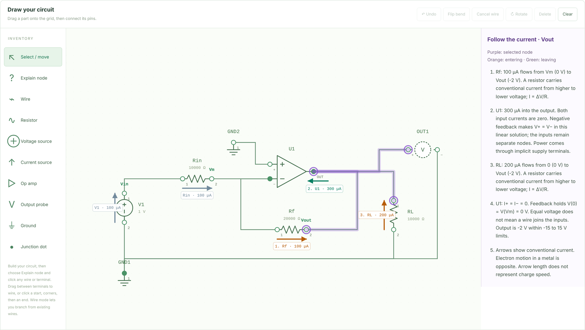
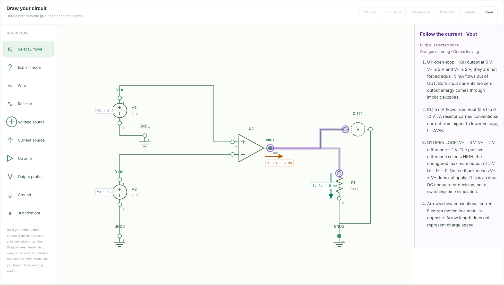
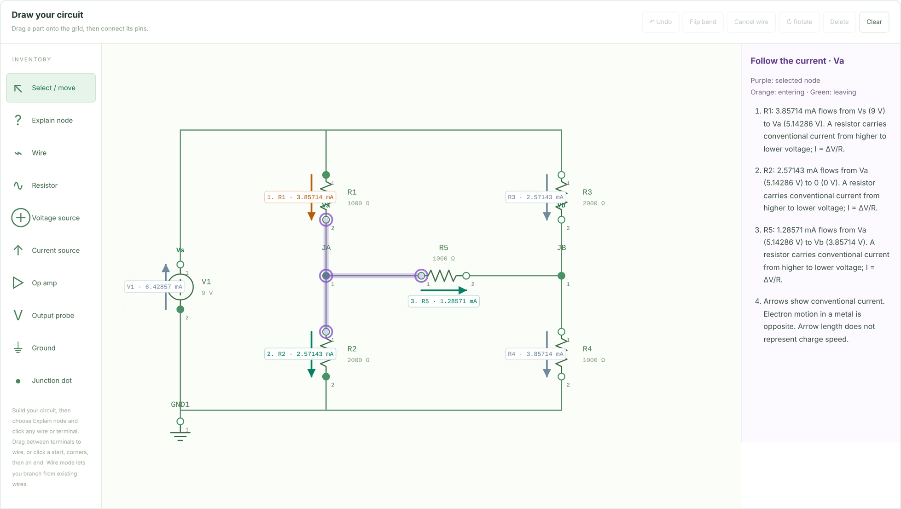

# CircuitScope

**Draw a DC circuit in the browser, solve it with Modified Nodal Analysis, and see *why* every node has its voltage.**

CircuitScope is an interactive circuit solver and teaching tool. You place resistors, sources and op amps on a canvas and wire them together. A Python engine then builds and solves the circuit's system of equations. The result is drawn back onto the schematic as current arrows, highlighted nodes and a step-by-step KCL explanation. The solver is validated against hand calculations and against **ngspice**.


*An inverting amplifier (gain −2). The selected node is Vout. Arrows show the solved branch currents, and the side panel explains each one.*

Built with Python, NumPy, Streamlit and vanilla JavaScript/SVG.

---

## Features

- **Schematic editor.** Drag-and-drop parts, click-to-route wires with manual corners, branch junctions, rotation, undo, and JSON save/load.
- **Modified Nodal Analysis solver** for resistors, independent voltage/current sources, and ideal op amps in two modes: **negative feedback** and **open-loop comparator**.
- **Analyses:** node voltage, open-circuit output voltage, branch current, component power, and **Thévenin / Norton equivalents** between any two nodes.
- **Click-to-explain lessons.** Click any wire or terminal to see the node highlighted, numbered current arrows, the symbolic KCL equation, and a numerical check that currents balance.
- **Circuits I methods.** Step-by-step explanations of supernodes, superposition, source transformations, voltage dividers, negative-feedback paths and summing amplifiers, applied to your own drawing, with seven worked course examples checked against hand answers.
- **Screenshot import.** Upload a photo or screenshot of a circuit and convert it into an editable schematic (OpenAI vision API, your own key). A required review step lets you correct every component and connection before loading.
- **Guided practice.** Nine predict-then-check questions with hints, unit-aware grading and worked solutions.
- **SPICE export** to LTspice or ngspice netlists.
- **Validation:** 29 configurations checked against ngspice (293 comparisons), 11 reference circuits checked against hand calculations (153 comparisons), and an end-to-end browser test suite.

---

## How it works

```
 Canvas (JS/SVG)  ──drawing JSON──▶  topology.py  ──netlist──▶  engine.py  ──solution──▶  teaching.py
 parts + wires                      union-find on              build & solve             lessons, arrows,
 with positions                     wired terminals            A·x = b (NumPy)           KCL equations
                                                                    │
                                                                    └──▶ spice_export.py ──▶ .cir netlist
```

**1. Drawing → netlist (`topology.py`).** Each wire connects two terminal IDs, such as `R1:2` and `U1:1`. A **union-find (disjoint-set)** structure groups connected terminals into electrical nodes, and every ground symbol merges into node `0`. Positions never enter the math: crossing lines don't connect, and moving a part doesn't change the circuit.

**2. Netlist → equations (`engine.py`).** The unknown vector holds every non-ground node voltage, plus one current for each voltage source and each op-amp output. Each component *stamps* its contribution into the matrix `A` and the vector `b`:

| Component | Stamp |
|---|---|
| Resistor | Adds conductance `1/R` to its two node rows (KCL) |
| Current source | Adds its current to `b` at its two nodes |
| Voltage source | Adds a current unknown, plus the constraint row `V(n1) − V(n2) = Vs` |
| Op amp, feedback | Adds an output-current unknown at OUT only, plus the constraint row `V(+) − V(−) = 0`. No current enters either input. |
| Op amp, comparator | Same output-current unknown, but the constraint row is `V(OUT) = HIGH or LOW level` |

`numpy.linalg.solve` returns all voltages and source currents at once. A singular matrix is reported as "no unique DC solution" instead of silently returning garbage.

**3. Comparator iteration.** A comparator's output depends on its solved inputs, so the solver starts every comparator LOW, solves, compares each one's inputs, updates any output that disagrees, and solves again. It stops only when every output agrees with its own comparison. A feed-forward chain of N comparators settles in at most N + 1 solves. Equal inputs (within ±1 nV) are reported as an undefined decision rather than guessed.

**4. Equivalent circuits.** For Thévenin, the engine solves the open-circuit voltage with the load removed. It then deactivates the independent sources (V → short, I → open), injects a 1 A test current across the port, and reads the resulting voltage as R<sub>th</sub>. Feedback op amps stay active during this step, so they correctly give R<sub>th</sub> = 0. Circuits containing comparators are rejected, because a switching output has no linear equivalent.

**5. Op-amp topology checks (`circuit_model.py`).** Before solving, a graph search from each op amp's output checks its feedback. A feedback amplifier must reach its − input through resistors, and must not reach its + input. A comparator must reach neither input, including through other amplifiers, which rules out latches and oscillators. After solving, feedback outputs are checked against their limits, so a circuit that would saturate is reported instead of returning an invalid linear result.

**6. Teaching layer (`teaching.py`).** The lesson is built from the solved circuit. It writes the KCL equation symbolically, separates truly known voltages (set by grounded sources) from coupled unknowns, and checks that current entering the node equals current leaving.


*An open-loop comparator. V+ = 3 V is above V− = 2 V, so OUT takes its configured 5 V HIGH level and drives 5 mA through the load.*

---

## Validation

### Against ngspice

`spice_export.py` converts each reference configuration into a SPICE netlist, and `spice_validate.py` runs it through **ngspice-42** and compares every node voltage and branch current.

| Configurations | Comparisons | Result | Max voltage deviation |
|---|---|---|---|
| 29 (11 full circuits, 9 open ports, 9 resistance tests) | 293 | All pass | ≈ 6 × 10⁻⁹ V |

The small deviation comes from SPICE's finite-gain (10⁹) op-amp model versus CircuitScope's exact `V+ = V−` constraint. The report in `validation/spice_report.json` records SHA-256 hashes of the solver sources, and the app shows it only while those hashes match the current code. Details: [docs/spice-validation.md](docs/spice-validation.md).

### Against hand calculations

Every reference answer is a fixed value **derived by hand**, never taken from the solver's own output. `verification.py` runs each circuit through the full pipeline (drawing → topology → engine) and checks node voltages, signed branch currents, KCL at every node, total power balance, the Thévenin/Norton port, and each op amp's input equality or comparator decision.

| Reference circuit | Key result |
|---|---|
| Parallel paths | Va = 7.2 V, R<sub>th</sub> = 2000/3 Ω |
| Voltage divider | Va = 8 V |
| Current source + resistor | Va = 6 V |
| Floating voltage source (supernode) | Va = 2 V, Vb = −4 V |
| Loaded resistor bridge | Va = 36/7 V, V<sub>th</sub> = 3 V, R<sub>th</sub> = 4000/3 Ω |
| Inverting op amp | Vout = −2 V |
| Non-inverting op amp | Vout = 3 V |
| Voltage follower | Vout = 2 V with zero output current |
| Unloaded resistor output | Vout = 12 V with zero current |
| Comparator HIGH | Vout = 5 V (0 / 5 V levels) |
| Comparator LOW | Vout = −12 V (±12 V levels) |

All 11 pass, 153 comparisons in total. Hand derivations are in [docs/reference-cases.md](docs/reference-cases.md). The tests also feed deliberately wrong solver results to the verifier, to confirm that it catches them.

### Browser tests

A Playwright suite drives the live Streamlit app in Chromium with real mouse, keyboard and drag-and-drop input. All 19 workflow checks pass, including the course methods and the screenshot review flow. Running it found and fixed four real bugs, including duplicate event listeners and a remount that lost undo history. Details: [docs/browser-tests.md](docs/browser-tests.md).


*A loaded Wheatstone-style bridge. Va and Vb are coupled through R5, so they must be solved together.*

---

## Getting started

Requires Python 3.10+.

```bash
git clone https://github.com/yabdelmesih-ops/circuitscope.git
cd circuitscope
pip install -r requirements.txt
streamlit run drawing_app.py
```

On Windows you can also double-click `RUN_CIRCUITSCOPE.bat`.

**Try it:** open *Example circuits and solver checks* and load **Op amp · inverting amplifier**. Choose *Explain node* in the inventory and click the output wire. See the [user guide](docs/user-guide.md) for all editor controls.

### Running the tests

```bash
python -m unittest discover -s tests -v   # Python: topology, engine, op amps, course methods, practice, SPICE, import, app
npm install
npm test                                  # JavaScript: wiring geometry and editor DOM (jsdom)
npm run test:browser                      # End-to-end: live app in Chromium (Playwright)
python spice_validate.py                  # Optional: re-run the ngspice validation (needs ngspice)
```

---

## Project structure

```
drawing_app.py       Streamlit app: questions, results, lessons, export
engine.py            MNA construction and solve, comparator iteration, Thévenin/Norton
circuit_model.py     Shared conventions, op-amp feedback and comparator checks
topology.py          Drawing → netlist (union-find), input validation
teaching.py          Node lessons: KCL equations, current directions
course_methods.py    Supernodes, superposition, transformations, dividers, feedback, summing amps
course_examples.py   Course example drawings with hand-derived answers
course_ui.py         Circuits I methods interface
practice.py          Guided-practice questions and grading
practice_ui.py       Guided-practice interface
screenshot_import.py Image preparation and structured netlist request (OpenAI API)
screenshot_ui.py     Screenshot upload and review interface
diagram_import.py    Netlist → editable drawing, safe SVG preview
spice_export.py      LTspice / ngspice netlist export
spice_validate.py    ngspice validation runner and report
examples.py          Reference circuits with hand-derived answers
opamp_examples.py    Op-amp and comparator reference circuits
verification.py      Compares engine output to reference answers
canvas/              Schematic editor (HTML/CSS/JS, Streamlit component)
tests/               Python unittest, Node and Playwright suites
validation/          ngspice report and decks, browser test report
docs/                Design documentation
```

**Further reading:** [architecture](docs/architecture.md) · [op-amp model](docs/op-amp-model.md) · [SPICE validation](docs/spice-validation.md) · [reference cases](docs/reference-cases.md) · [Circuits I methods](docs/circuits-i-methods.md) · [screenshot import](docs/screenshot-import.md) · [guided practice](docs/guided-practice.md) · [browser tests](docs/browser-tests.md) · [user guide](docs/user-guide.md)

---

## Scope and limitations

CircuitScope models **DC circuits** with resistors, independent ideal sources, ideal op amps with resistive negative feedback, and ideal two-level comparators (up to eight per drawing). It does not simulate capacitors, inductors, AC or transient behavior, dependent sources, hysteresis, closed-loop saturation, or real op-amp imperfections such as finite gain, offset, bias current or slew rate. The ngspice validation covers the reference circuits; LTspice-format decks are included but were not run in LTspice.

## Roadmap

- [ ] Run the included decks in LTspice
- [ ] Capacitors and inductors (DC steady state, then transient)
- [ ] Voltage-controlled dependent sources
- [ ] Comparator hysteresis (Schmitt trigger)
- [ ] AC phasor analysis with complex MNA

---

**Youssef Abdelmesih** · Electrical Engineering, UMass Amherst · [LinkedIn](https://www.linkedin.com/in/youssef-abdelmesih-848a5738a)
